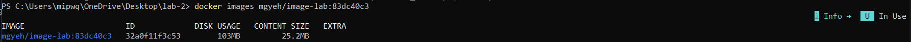
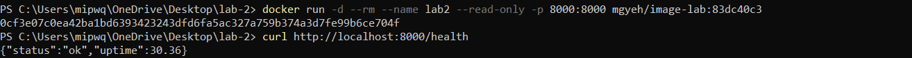

# Лабораторная работа №2

## Чем мой образ лучше «наивной» сборки (размер, безопасность, кэш и т.д.)

* Маленький размер: За счет `multi-stage` в итоговом образе есть только сам код и готовые библиотеки.

  
  
* Безопасность: Приложение запускается под обычным созданным пользователем `appuser`, а не под root.
  
* `HEALTHCHECK`: Внутри образа настроена автоматическая проверка. Система сама каждые 30 секунд опрашивает /health, чтобы убедиться, что сервис работает стабильно.

* Работа в режиме `--read-only`: За счет режима `только для чтения` повышается общая надежность и безопасность системы, так как вредоносные программы не смогут ничего изменить или внедрить в сам файл.

  

* Корректная остановка (`SIGTERM`): Благодаря запуску `exec-формы` `Python` запускается напрямую без оболочки `sh` и становится главным процессом (`PID 1`), мгновенно принимая системные сигналы остановки.

* Гибкость: Все важные параметры и метки передаются через переменные окружения, поэтому программу не нужно пересобирать заново при каждом изменении конфигурации.

* Быстрое обновление: Благодаря разделению на слои, повторная сборка происходит гораздо быстрее, так как Docker использует кэш уже установленных библиотек.

PS: Из-за размера распакованного образа был поменян `python:3.11-slim` на `python:3.11-alpine`, который весит меньше(скриншот готового образа прилагается). Скриншот доказательства работы с `--read-only` также был добавлен. Поменялось объяснение завершения `SIGTERM`. Объяснение про `Gunicorn` и значение `.dockerignore`(добавлен в `Git`), а также отличие его от `.gitignore`:

* Пакет `Gunicorn` добавлен в образ заранее как `production-стандарт`, чтобы сервис можно было запустить под высокой нагрузкой в несколько параллельных рабочих процессов без пересборки контейнера. Запустить можем, например, через `gunicorn -w 2 -b 0.0.0.0:8000 app.app:app`, которая запустит сразу главный процесс и 2 независимых процесса, которые будут параллельно принимать и обрабатывать входящие `HTTP-запросы`.
  
* Файл `.dockerignore` управляет тем, какие локальные файлы и папки не должны передаваться демону Docker при сборке образа. Он защищает от случайного попадания ключей и не только в слои образа при выполнении директив вроде `COPY`, уменьшает объем данных, пересылаемых клиентом сборщику на первом шаге и не дает сборщику сбрасывать кэш шагов `COPY` из-за изменения локальных логов, системного мусора или временных файлов `Python` (`__pycache__`, `*.pyc`).

  * `.dockerignore` - Нужен для сборщика контейнеров `Docker`. Не дает файлам попасть в контекст сборки и в итоговый `Docker-образ`.
    
  * `.gitignore` - Нужен для системы контроля версий `Git`. Не дает файлам попасть в коммиты и в удаленный репозиторий.

  * Если коротко, то папка `.git` находится под управлением `Git` и не добавляется в `.gitignore`, но в `.dockerignore` ее обязательно нужно прописать, чтобы внутренняя история репозитория не отправлялась в `Docker` при каждой сборке.
