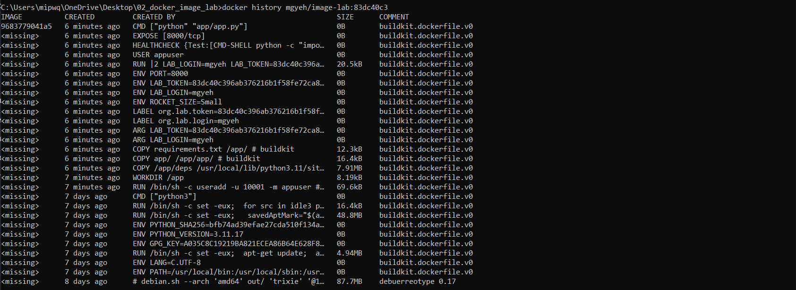

# Лабораторная работа №2

## Чем мой образ лучше «наивной» сборки (размер, безопасность, кэш и т.д.)

* Маленький размер: За счет `multi-stage` в итоговом образе есть только сам код и готовые библиотеки.

* Безопасность: Приложение запускается под обычным созданным пользователем `appuser`, а не под root.
  
* `HEALTHCHECK`: Внутри образа настроена автоматическая проверка. Система сама каждые 30 секунд опрашивает /health, чтобы убедиться, что сервис работает стабильно.

* Работа в режиме `--read-only`: За счет режима `только для чтения` повышается общая надежность и безопасность системы, так как вредоносные программы не смогут ничего изменить или внедрить в сам файл.

* Корректная остановка (`SIGTERM`): Приложение запускается напрямую через `python`, поэтому оно мгновенно реагирует на сигнал остановки и корректно выключается, не зависая и не теряя данные.

* Гибкость: Все важные параметры и метки передаются через переменные окружения, поэтому программу не нужно пересобирать заново при каждом изменении конфигурации.

* Быстрое обновление: Благодаря разделению на слои, повторная сборка происходит гораздо быстрее, так как Docker использует кэш уже установленных библиотек.
