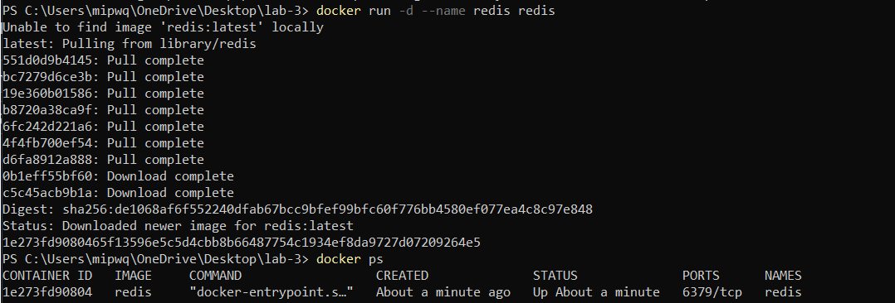
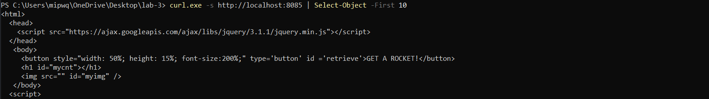

# Лабораторная работа 3

## Задание 1

### Создание redis. Проверка: docker ps показывает контейнер redis в состоянии Up.

 ```bash

  docker run -d --name redis redisdocker run -d --name redis redis
  docker ps

```



### Запуск приложения Rocket Counter с флагом --link и его проверка

 ```bash

  docker run -d --name rocketcounter -p 8085:5000 --link redis:redis rotorocloud/rocket-counter

```


### С помощью команды выводим первые 10 строк HTML-разметки страницы Rocket Counter. 

  * Аналог `curl -s localhost:8085 | head -n 10`, используем другую команду, так как утилиты head по умолчанию нет в PowerShell.
     
 ```bash

  curl.exe -s http://localhost:8085 | Select-Object -First 10

```


### Страница сайта, где при нажатии на кнопку `GET A ROCKET!` увеличивается 
