# Лабораторная работа 3

## Задание 1

### Создание `redis`. Проверка: `docker ps` показывает контейнер `redis` в состоянии Up.

 ```bash

  docker run -d --name redis redis
  docker ps

```


### Запуск приложения Rocket Counter с флагом `--link` и его проверка

 ```bash

  docker run -d --name rocketcounter -p 8085:5000 --link redis:redis rotorocloud/rocket-counter

```

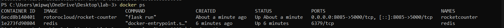

### С помощью команды выводим первые 10 строк HTML-разметки страницы Rocket Counter. 

  * Аналог `curl -s localhost:8085 | head -n 10`, используем другую команду, так как утилиты head по умолчанию нет в `PowerShell`.
     
 ```bash

  curl.exe -s http://localhost:8085 | Select-Object -First 10

```


### Страница сайта, где при нажатии на кнопку `GET A ROCKET!` увеличивается 

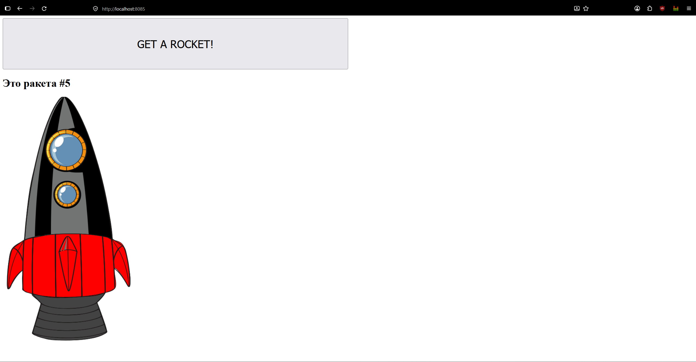

### Удаление контейнеров `redis` и `rocketcounter`

 ```bash

  docker stop rocketcounter redis
  docker rm rocketcounter redis

```

Убеждаемся, что список запущенных и остановленных контейнеров пуст

 ```bash
  docker ps -a
```

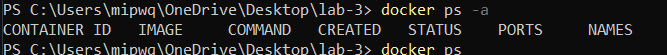

## Задание 2

### Создание каталога `rocketcounter` и переход в него.

 ```bash

  mkdir rocketcounter
  cd rocketcounter

```

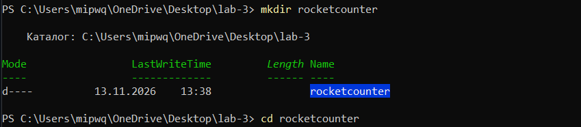

### Создание файла `docker-compose.yml` с требованиями:

```yaml

  services:
    redis:
      image: redis
  
    rocketcounter:
      image: rotorocloud/rocket-counter
      ports:
        - "8085:5000"

```

### Запустим стек

 ```bash

  docker compose up

  #Для дальнейшей работы запустим с фоновом режиме с помощью флага `-d`
  docker compose up -d
  
```

Проверка запущенных контейнеров

 ```bash
   docker compose ps
```

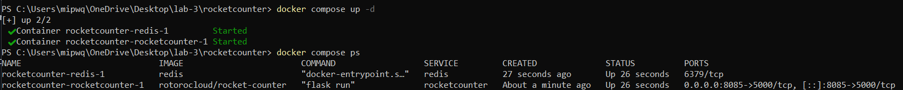

Проверка открытия страницы с счетчиком 

 ```bash

   curl.exe -s http://localhost:8085 | Select-Object -First 10
  
```

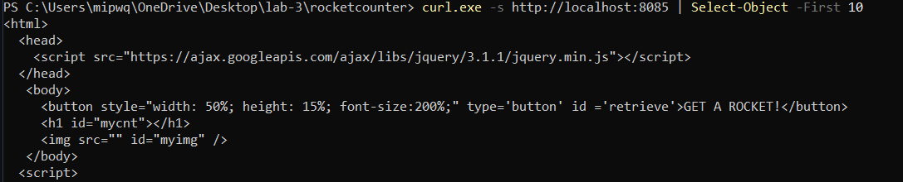

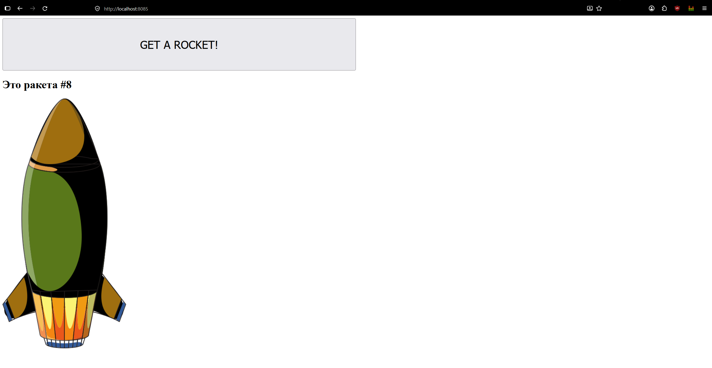

## Задание 3

### Заменяем публикацию портов на динамическую, изменив ports: - "8085:5000" на ports: - "0:5000"

```yaml

services:
  redis:
    image: redis

  rocketcounter:
    image: rotorocloud/rocket-counter
    ports:
      - "0:5000"

```

### Применяем изменения и масштабируем

 ```bash

  docker compose up -d --scale rocketcounter=2
  docker compose ps

```

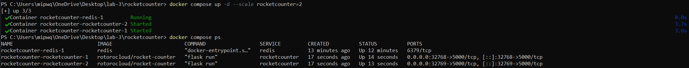

### Убеждаемся, что счетчик общий у обоих экземпляров

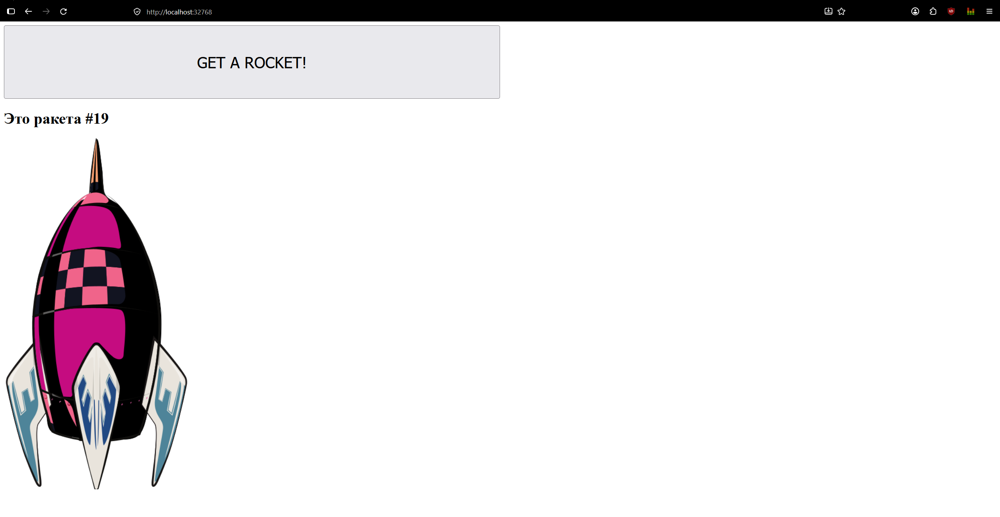

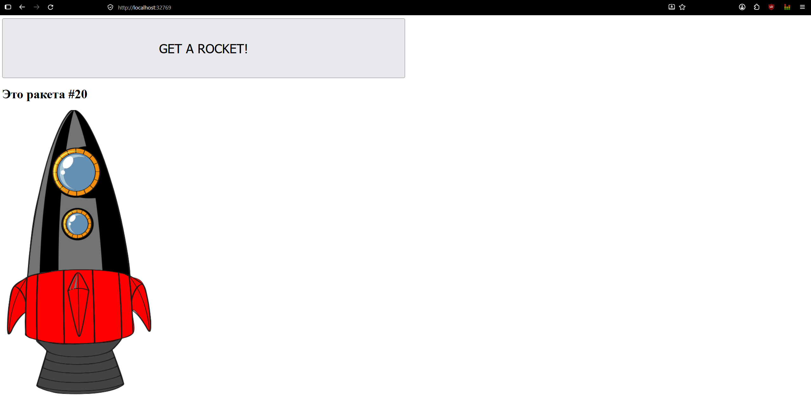

Счетчик общий, на скриншотах различие в единицу, так как при обновлении страницы счетчик не показывается и, нажав на `GET A ROCKET!`, счет начнется с того момента, где остановился другой `rocketcounter`

## Задание 4

С помощью команды уничтожаем полностью стек

 ```bash
  docker compose down -v
```

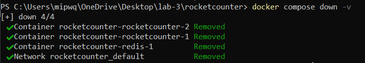

Проверка очистки 

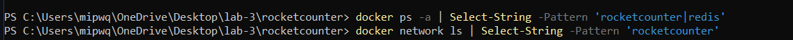

У нас все пусто, поэтому все уничтожилось

## Вопросы

1. Зачем в Ч.1 использовался `--link` и почему в Compose он не нужен?
   В Ч.1 намеренно использовался `--link` для того, чтобы посмотреть ручную связку. В `Compose` это не нужно: он сам создает отдельную сеть со встроенным `DNS`, где сервисы автоматически видят друг друга по именам. 
2. Чем отличается `image` от `build` в Compose?
   * `image` берет уже готовый образ из интернета (например, с `Docker Hub`) или из локального кэша. Ничего компилировать и собирать не нужно.
   * `build` заставляет `Docker` самому собрать образ с нуля по инструкции из локального `Dockerfile` прямо перед запуском.
3. Почему нельзя масштабировать сервис с публикацией фиксированного порта на одном хосте? Перечислите способы обойти это ограничение.
   Операционная система не даст двум разным контейнерам одновременно занять один и тот же порт на одном IP-адресе (возникнет конфликт).
   Обойти это можно тремя способами:
   * Выдавать случайные порты через "0:5000".
   * Поставить спереди балансировщик (Nginx или Traefik), который заберет один порт себе и раскидает трафик по репликам.
   * Использовать оркестраторы вроде Docker Swarm, Kubernetes. У них внутри есть собственный механизм маршрутизации, который умеет принимать трафик на один порт и прозрачно делить его между десятками копий приложения.
4. Что делает `docker compose down -v` и чем отличается от `down` без `-v`?
   Обычный `docker compose down` останавливает и удаляет сами контейнеры, а также созданную для них виртуальную сеть. Но если к базе данных был привязан том с данными, он останется лежать на диске. Флаг -v сносит вообще все подчистую, включая эти тома с данными. После такой команды при следующем запуске мы получим чистую систему с пустой базой данных.
5. Как в Compose обеспечивается сетевое имя сервиса для обращения из другого сервиса?
   `Compose` объединяет все сервисы в одну виртуальную сеть `bridge`, внутри которой работает встроенный `DNS-сервер Docker`. Он берет имена сервисов из `docker-compose.yml` и сам подставляет вместо них актуальные внутренние `IP-адреса ` контейнеров.
